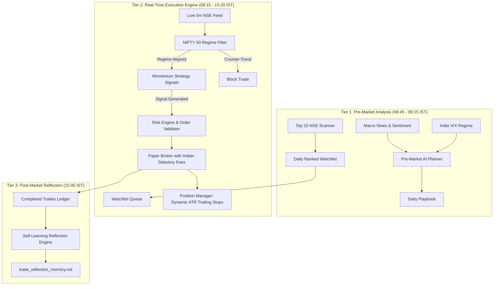

# Agentic AI Trading Bot for Indian Markets (NSE)

An autonomous, systematic trading bot engineered for Indian equity markets. Combines strategic AI pre-market research and post-market reflection with a sub-second, deterministic quantitative execution engine and hard risk circuit breakers.

---

## 🏛️ Architecture Overview

The bot employs a **Two-Tier Architecture** that completely decouples high-level AI reasoning from fast intraday execution, eliminating LLM latency and API rate-limit bottlenecks:



---

## 🚀 Key Features

1. **NIFTY 50 Index Market Regime Filter (`src/data/market_regime.py`)**:
   - Classifies broader market into `BULLISH_TREND`, `BEARISH_TREND`, `SIDEWAYS_CHOP`, and `HIGH_VOLATILITY`.
   - Prevents counter-trend trades (e.g. rejects long equity breakouts when NIFTY 50 is dumping).

2. **Multi-Stock Opportunity Scanner (`src/data/scanner.py`)**:
   - Scans liquid large-cap NSE stocks (`RELIANCE`, `TCS`, `INFY`, `HDFCBANK`, `ICICIBANK`, `SBIN`, etc.).
   - Computes a composite momentum score based on ADX, RSI, and Relative Volume (`RVOL`) to curate the top 3 runners for each day.

3. **Dynamic ATR Volatility Stops & Two-Stage Trailing Stops**:
   - **Initial Stop-Loss:** $1.5 \times \text{ATR}$ (clamped between 0.8% and 2.5%).
   - **Take-Profit:** Strict 2:1 Reward-to-Risk ($3.0 \times \text{ATR}$).
   - **Milestone 1 (+1.0R):** Moves Stop-Loss to Breakeven ($\text{Entry Price}$).
   - **Milestone 2 (+1.5R):** Trails Stop-Loss to lock in $+0.75\text{R}$ guaranteed profit.

4. **Realistic Indian Statutory Fee Engine (`src/execution/fees.py`)**:
   - Accurately models Securities Transaction Tax (STT), Exchange Turnover Fees, SEBI Charges, Stamp Duty, and 18% GST on all mock orders.

5. **Hard Capital Circuit Breakers (`src/core/daily_goal_manager.py`)**:
   - Daily target profit: **+₹1,500 (+1.5%)** (locks in profits and halts trading for the day).
   - Daily max loss limit: **-₹1,000 (-1.0%)** (prevents tilt and catastrophic drawdown).
   - End-of-Day auto square-off at **15:20 IST** (zero overnight market risk).

6. **Minimalist Web Dashboard (`src/dashboard/app.py`)**:
   - Dark-mode control center with live system status, real-time daemon logs, and trading metrics.
   - Bound strictly to `127.0.0.1:8080` for secure SSH-tunneled access.

---

## 🛠️ Project Structure

```
.
├── config/                  # Configuration files
│   ├── settings.yaml        # Risk parameters, symbols, capital limits
│   └── secrets.env.example  # API key templates
├── data/                    # Persistent storage
│   ├── daily_goal_state.json
│   ├── daily_playbook.json
│   └── trade_reflection_memory.md
├── docs/                    # Architectural documentation
├── scripts/                 # Operational executables
│   ├── run_daily_bot.py     # Main autonomous daemon
│   └── download_data.py     # Historical NSE candle downloader
├── src/
│   ├── agents/              # Pre-market planner & LLM reflection agents
│   ├── backtest/            # Vectorized backtesting engine
│   ├── core/                # Models, enums, config, daily goal manager
│   ├── dashboard/           # FastAPI web dashboard
│   ├── data/                # Live feeds, indicators, regime filter, scanner
│   ├── execution/           # Paper broker, fees, order validator
│   ├── risk/                # Position sizer, ATR stop loss, circuit breaker
│   └── strategy/            # Momentum and Mean Reversion strategies
├── systemd/                 # Production systemd unit service files
├── tests/                   # Automated unit & integration test suite
├── Dockerfile               # Production container image
└── docker-compose.yml       # Turnkey multi-container orchestration
```

---

## ⚡ Quick Start

### Option A: Running with Docker Compose (Recommended)

1. Clone repository and set up environment:
   ```bash
   git clone https://github.com/Gauthamraju31/agentic-trading-bot.git
   cd agentic-trading-bot
   cp .env.example .env
   ```

2. Start both the bot daemon and web dashboard:
   ```bash
   docker compose up -d --build
   ```

3. View live logs:
   ```bash
   docker compose logs -f bot
   ```

4. Access Dashboard:
   Open `http://localhost:8080` in your browser.

---

### Option B: Native Python Environment

1. Requirements: **Python 3.12+**
   ```bash
   python3 -m venv .venv
   source .venv/bin/activate
   pip install -e .[dev,brokers,alerts]
   ```

2. Run single test tick to verify setup:
   ```bash
   python scripts/run_daily_bot.py --test
   ```

3. Run the autonomous daemon:
   ```bash
   python scripts/run_daily_bot.py
   ```

4. Run the web dashboard:
   ```bash
   uvicorn src.dashboard.app:app --host 127.0.0.1 --port 8080
   ```

---

## 🧪 Testing

Run the full automated test suite:
```bash
pytest tests/ -v
```

---

## 🔒 Security Notice

By design, the web dashboard binds strictly to `127.0.0.1:8080` and is not exposed to the public internet. If running on a remote cloud server (e.g., `rick`), access the dashboard securely via SSH port forwarding:
```bash
ssh -N -L 8080:localhost:8080 <your-server-alias>
```
Then navigate to `http://localhost:8080` locally.
